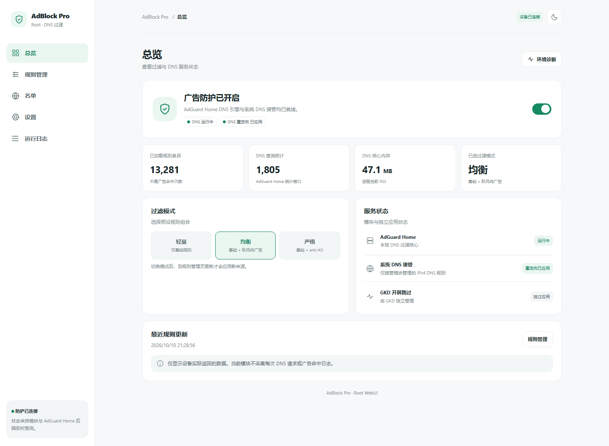
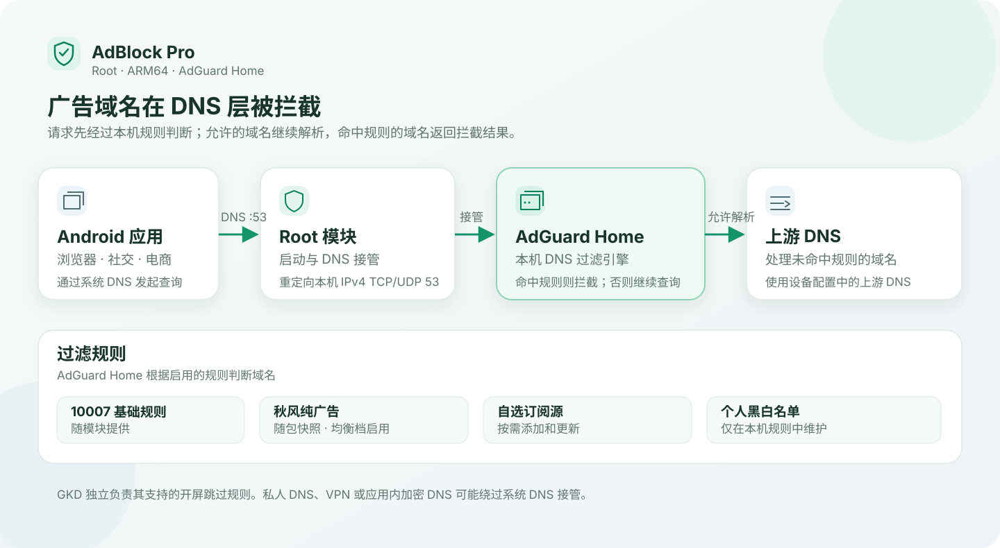

# AdBlock Pro

**把广告域名挡在 DNS 查询阶段。**

为 Root Android 准备的本地 DNS 过滤与规则管理工具

   

[**新仓库 Releases**](https://github.com/Ccmra404/AdBlock-Pro-next/releases) · [**使用指南**](docs/guide.md) · [**反馈问题**](https://github.com/Ccmra404/AdBlock-Pro-next/issues)

当前源码的 WebUI 界面预览。状态、条数和内存使用演示数据，不代表真机测试结果。

AdBlock Pro 在手机本地运行 **AdGuard Home**，通过 Root 模块接管 IPv4 DNS 请求，过滤广告与部分跟踪域名。**均衡规则随包提供**；需要调整时，再添加订阅或维护个人名单。

> [!NOTE]
> 新仓库的源码基线沿用 **v0.13.0-rc.3（versionCode 45）**；安装包和 Release 不会从旧仓库自动迁移。新仓库尚未发布安装包，请勿把 GitHub 自动生成的 Source code ZIP 当成可安装模块。

## 过滤、维护、排查，一个入口

| | 能做什么 |
| --- | --- |
| **开箱即用** | 内置 10007 与秋风纯广告快照，均衡档首次使用无需下载规则 |
| **按需选择** | 轻量、均衡、严格三档；每档独立管理附加订阅，支持 HTTPS 自定义来源 |
| **个人规则** | 搜索、增删和导出黑白名单；与第三方订阅分开保存 |
| **看清状态** | 查看核心运行、DNS 重定向、已加载规则和进程内存；运行环境诊断 |
| **排查漏拦截** | 检查域名命中规则，短时观察新 DNS 域名，人工确认后加入个人规则 |
| **留有恢复入口** | 更新快照与历史回滚；核心异常退出后尝试撤销本模块重定向，支持手动紧急解除接管 |

WebUI 支持手机与桌面布局、深浅色主题。日志和名单提供搜索与分页，命令输出按需展开。

## 三档预设，按需要加规则

| 档位 | 默认组合 | 使用建议 |
| --- | --- | --- |
| **轻量** | 10007 基础规则 | 优先控制规则规模 |
| **均衡** | 10007 + 秋风纯广告 | 默认起点，两份规则均随包提供 |
| **严格** | 10007 + anti-AD EasyList | 需要更多域名覆盖时使用，附加源需联网下载 |

三个档位都保留个人黑白名单。各档附加源可以启停、删除或导入，切换档位不会删除其他档位的配置。

**选择档位、修改订阅或名单后，在「规则管理」执行更新才会生效。** 规则规模会影响内存占用；从均衡档开始，遇到明确漏拦截再增加来源，比堆叠大量重复规则更便于维护。

## 开始使用

1. 准备运行 KernelSU、Magisk 或 APatch 的 **Android ARM64** 设备，停用其他会争用 AdGuard Home 服务或 DNS 端口的模块。
2. 新仓库完成重新验收并发布 ARM64 安装包后，再从 [Releases](https://github.com/Ccmra404/AdBlock-Pro-next/releases) 下载；当前新仓库还没有可安装包。
3. 打开模块 WebUI，在**总览**查看核心与重定向状态，运行一次**环境诊断**。
4. 先使用均衡档；需要额外规则时，在**规则管理**调整来源并执行更新。

首次安装的后台默认账号为 `admin`，密码为 `password`，仅监听本机；升级保留已有账号和配置。开放远程访问前先修改默认密码。后台登录、故障恢复与开机参数见 [使用指南](docs/guide.md)。

### Root 管理器适配

| 环境 | 模块运行 | WebUI 入口 | 当前验证 |
| --- | --- | --- | --- |
| **KernelSU** | 共用安装与启动逻辑 | 支持模块 WebUI 的管理器 | 模拟回归通过，rc.3 待真机验收 |
| **KernelSU 衍生版** | 以沿用标准模块接口的版本为目标，如 KernelSU-Next、ReSukiSU | 需兼容 `ksu.exec` 接口 | 待逐版本验收 |
| **Magisk** | 共用安装与启动逻辑 | 使用支持 KernelSU 接口的第三方宿主，如 [WebUI X](https://github.com/MMRLApp/WebUI-X-Portable) | 模拟回归通过，待真机验收 |
| **APatch** | 共用安装与启动逻辑 | APatch 管理器 WebUI | 模拟回归通过，待真机验收 |

一份 ARM64 ZIP 用于上述环境。安装前检查完整 BusyBox、curl 和 IPv4 iptables；缺少依赖会停止安装。当前 DNS 模式不覆盖系统文件，**无需为本模块单独安装挂载元模块**。不同 ROM、Root 版本及 WebUI 宿主的权限行为仍需分别测试。

## 它与 AdGuard Home 怎么配合？

**AdGuard Home 负责 DNS 过滤；AdBlock Pro 负责 Android 模块运行与日常维护。**

WebUI 管理档位、订阅、个人名单、接管开关和任务日志。上游 DNS、高级过滤设置与查询日志使用 AdGuard Home 原生后台，入口放在**系统设置**中。

<b>展开查看 DNS 过滤流程</b>

本模块将 IPv4 的 TCP/UDP 53 请求重定向到本地核心。AdGuard Home 根据规则返回拦截结果，或向配置的上游 DNS 查询允许的域名。

## 使用边界

- **默认只接管 IPv4 明文 DNS。** 私人 DNS、VPN、应用内 DoH/DoT 和 IPv6 查询可能绕过过滤。
- **域名过滤不等于删除广告界面。** 共用正常内容域名的广告、缓存广告和广告占位可能保留。开屏跳过可独立搭配 [GKD](https://github.com/gkd-kit/gkd)。
- **域名观察需要人工判断。** 观察期间的候选来自整台手机，无法精确归因到单个应用，也不会自动认定为广告。
- **诊断状态不等于实际拦截验证。** 监听与重定向正常后，仍需在自己的网络、VPN 和应用环境下测试。

遇到解析异常，先在**系统设置 → 紧急解除接管**撤销模块重定向，再查看日志。详细排查步骤见 [使用指南](docs/guide.md#常用排查命令)。

## 按需诊断占用

在运行日志中执行环境诊断，或使用 `bindhosts.sh --storage-report`，可分别查看模块、规则缓存、历史快照、任务日志的磁盘占用，以及 DNS 进程的 RSS/PSS。诊断只读取指标，不清理用户数据，也不加入常规状态轮询。完成任务日志最多保留 200 项，每项上限 64 KiB。

## 上游内核跟踪

[GitHub Actions](.github/workflows/update-adguard-home.yml) 每周检查 AdGuard Home 官方稳定版，核对下载摘要、ARM64 架构和初始配置后提出独立 Draft PR。不会自动合并、发布或升级手机；当前内核没有因本次整合更换。启用自动建 PR 需要仓库允许 Actions 创建 Pull Request。

## 仓库协作与提交规范

当前整合阶段沿用 rc.3 的正式版本号，不覆盖已发布附件。历史 PR 的逐项取舍、保留边界和真机清单见 [整合与复审记录](docs/integration-rc3.md)。开发包仅保存在 Actions artifacts，并带 `-dev.<sha>` 标识；正式发布需人工确认后在 main 手动触发。

向项目提交代码或使用另一个本地 AI 编程会话协作时，请先阅读 [AGENTS.md](AGENTS.md) 与 [CONTRIBUTING.md](CONTRIBUTING.md)。所有改动应从最新 `main` 建立独立分支、提交 PR，按 [PR 检查清单](.github/PULL_REQUEST_TEMPLATE.md) 说明自动化测试、真机状态与发布风险；未经明确确认不覆盖已有 Release 或直接发布新版本。

## 来源与致谢

| 项目 | 用途 |
| --- | --- |
| [AdGuard Home](https://github.com/AdguardTeam/AdGuardHome) | 本地 DNS 过滤引擎 |
| [KernelSU](https://github.com/tiann/KernelSU) | Android Root 与模块平台 |
| [10007](https://github.com/lingeringsound/10007_auto) | 默认基础规则 |
| [AWAvenue Ads Rule](https://github.com/TG-Twilight/AWAvenue-Ads-Rule) | 均衡档的秋风纯广告规则 |
| [anti-AD](https://github.com/privacy-protection-tools/anti-AD) | 严格档默认附加源 |

第三方引擎和规则遵循各自的上游许可证。秋风规则的许可证副本见 [GPL-3.0](licenses/AWAvenue-GPL-3.0.txt)。

仓库中的初始个人名单随安装包提供；安装后的修改保存在设备本机。公开或分享个人配置前，检查其中的域名、查询记录与后台凭据。
