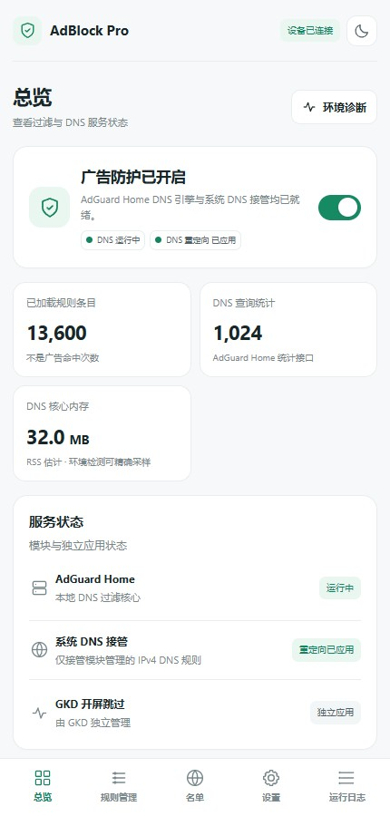
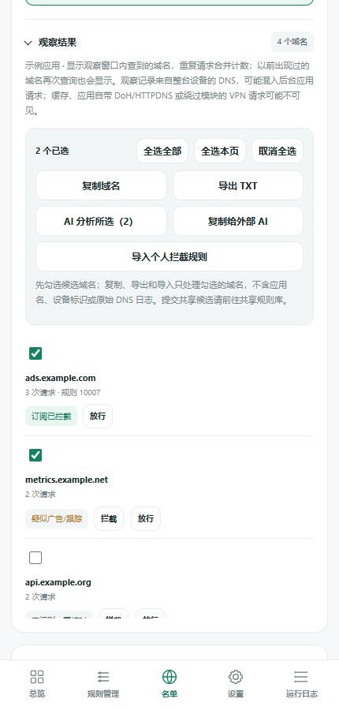
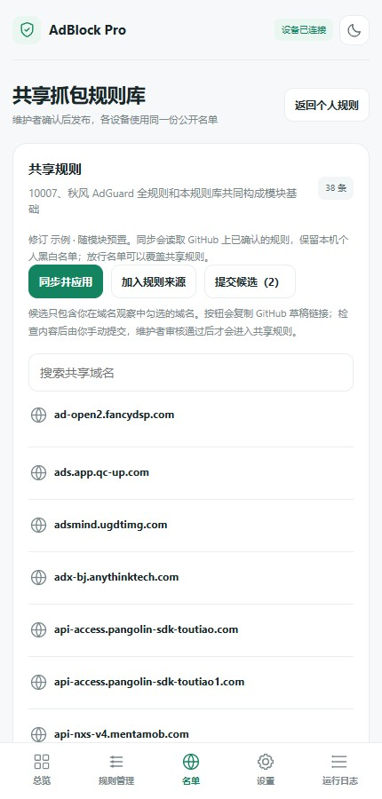

# AdBlock Pro

**让去广告更可控，让好规则一起用。**

基于 AdGuard Home 的 Android Root DNS 过滤模块，面向 KernelSU、Magisk 与 APatch 模块环境。

[GitHub 下载](https://github.com/Ccmra404/AdBlock-Pro-next/releases/latest) · [OpenList 下载](https://pan.112589.xyz/本地文件/AdBlock-Pro) · [使用指南](docs/guide.md) · [参与共建](docs/shared-app-rules.md#社区贡献) · [问题反馈](https://github.com/Ccmra404/AdBlock-Pro-next/issues) · [为爱发电](#为爱发电)

  
  
  

当前代码的本地演示界面；统计与观察数据仅为示例，不代表设备实测或拦截效果。

## AdBlock Pro 能做什么

在手机或平板上运行本地 DNS 过滤，按规则拦截广告和跟踪域名，并用 WebUI 管理订阅、个人名单与运行状态。

遇到仍然显示的广告，可以观察一段时间内的 DNS 请求，复制域名交给外部 AI，或使用模块内的可选 AI 接口辅助判断。确认后的域名可加入个人名单，也可提交到共享规则库，让一次排查帮助更多用户。

把**过滤、排查、判断和规则共建**连起来：日常用订阅过滤，遇到漏拦截就观察域名、辅助分析、实测补充，再把有用的规则分享给其他人。

## 主要功能

- **本地 DNS 过滤**：使用 AdGuard Home 处理经过模块的 DNS 请求；分别控制过滤、DNS 接管与核心启停。
- **订阅来源管理**：导入、启停、重命名、移除来源，修改订阅链接；支持 HTTPS 自定义来源与每日自动更新。
- **个人黑白名单**：手动添加、导入或导出拦截与放行域名；保存后单独应用，不必重新下载全部订阅。
- **应用过滤范围**：在设置中排除指定应用的明文 DNS 接管，其他应用继续按原规则过滤。保存后应用接管规则，无需下载订阅；[适用范围与限制](docs/application-filtering.md)。
- **短时域名观察**：搜索本机应用并启动观察，汇总观察窗口内的域名、查询次数与拦截状态；支持全选、复制和 TXT 导出。
- **可选 AI 分析**：提供 DeepSeek 预设与自定义兼容接口，分析所选域名并给出理由；也可复制给外部 AI，无需在模块配置密钥。
- **共享抓包规则**：同步已审核的公共规则，提交自己的候选域名；个人名单与共享库分开管理。
- **DNS 上游设置**：查看当前解析服务器，填入国内普通 DNS 或 DoH 预设，测试后保存；支持恢复上次配置，[查看说明](docs/dns-upstreams.md)。
- **VPN 自动兼容**：可选开关，检测到 TUN/WireGuard 接口时暂时旁路模块 DNS 接管，断开并稳定后按原设置恢复，核心保持运行，[查看适用范围](docs/vpn-compatibility.md#使用-vpntun-自动兼容)。
- **日志与网络诊断**：搜索、复制和导出操作记录，检查 DNS 核心、接管、IPv6、私人 DNS 和 VPN 状态；域名检查可查看规则命中原因，并将误拦截域名加入放行名单。
- **配置维护**：覆盖升级保留用户配置；提供规则历史恢复、导出备份和恢复默认设置。

### 规则由你决定

安装包预置 **10007**、**秋风 AdGuard 全规则**及**共享抓包规则**快照，首次安装可离线加载。你可以按需停用、移除或重新导入，不强制保留某个来源。另提供默认不启用的 **GOODBYEADS DNS** 及配套放行规则，可按需导入；不建议只为增加规则数量而叠加所有来源。

- **订阅来源**适合维护通用过滤规则，修改来源后执行规则更新。
- **个人名单**适合补充漏拦截或放行误拦截；编辑、导入及 AI 导入后自动单独应用。
- **共享规则**由维护者审核后发布，同步不会覆盖本机个人名单；本机放行名单可放行共享规则命中的域名。

规则更新失败时保留上一份有效规则，日志会显示下载、证书或校验错误。详细说明见[使用指南](docs/guide.md)。

## 安装与开始使用

### 安装条件

- Android **ARM64** 手机或平板，已安装 KernelSU、Magisk、APatch 或兼容的模块环境。
- Root 环境提供完整 BusyBox 和 IPv4 `iptables`；安装包自带 ARM64 `curl` 与 CA 证书。
- 避免同时运行争用 DNS 端口或接管规则的其他模块。各管理器与机型的验证范围以对应 Release 说明为准。

### 首次安装

1. 从 [GitHub Releases](https://github.com/Ccmra404/AdBlock-Pro-next/releases/latest) 或 [OpenList](https://pan.112589.xyz/本地文件/AdBlock-Pro) 下载完整 ARM64 模块 ZIP，**不要选择 GitHub 自动生成的 Source code 压缩包**。
2. 在 Root 管理器中安装 ZIP，完成后正常重启设备。
3. 打开模块 WebUI。KernelSU、APatch 使用管理器的 WebUI 入口；Magisk 需使用兼容 `ksu.exec` 的 WebUI 宿主，详见[管理器与工具兼容](docs/guide.md#管理器与工具兼容)。管理器的“操作”按钮用于启停核心，不是 WebUI 入口。
4. 在“总览”确认 DNS 核心运行、DNS 重定向已应用，再到“规则管理”选择需要的来源并执行更新。

后续升级直接覆盖安装新版 ZIP，保留既有账号、个人名单、订阅与偏好。模块管理器更新接入方式见[模块更新说明](docs/module-updates.md)。

### 日常使用

- **总览**：查看过滤、核心与 DNS 接管状态，以及规则数、查询统计和内存。
- **规则管理**：调整来源与订阅链接，更新规则，查看规则历史。
- **名单**：在顶部进行域名观察；管理个人拦截、放行名单，进入共享规则库。
- **设置**：调整 DNS 接管、VPN 自动兼容、上游 DNS、开机运行及每日更新；配置 AI，打开 AdGuard Home 后台或恢复默认设置。
- **运行日志**：查看任务进度和错误，运行环境诊断，搜索、复制或导出日志。

AdGuard Home 原生后台位于本机 `http://127.0.0.1:3000/`，首次安装默认账号为 `admin`、密码为 `password`；覆盖升级保留旧凭据。它与模块 WebUI 是两个入口，可在模块“设置”中打开。若自行开放远程访问，先修改默认密码。

## 从发现广告到完善规则

1. 在“名单”页顶部搜索应用名称或包名，选择匹配项，点击“开始并打开应用”。默认观察 10 秒，也可调整时长。
2. 返回后展开“观察结果”，查看这段时间内经过 AdGuard Home 的域名。**此前出现过的域名也会显示**，重复查询按域名汇总计数。
3. 勾选候选域名，复制或导出；需要辅助判断时，点“复制给外部 AI”，或在设置中配置接口后点“AI 分析所选”。
4. 核对分析理由与实际用途，再加入个人拦截名单。名单会自动单独应用；若应用失败，可点“应用个人名单”重试。随后重新打开目标应用，检查广告与正常功能。
5. 确认有用且没有误拦截后，可从共享规则库或 AI 结果中“提交共享候选”。模块生成 GitHub Issue 草稿链接，由你检查并提交，维护者审核后才进入公共规则。

观察可能包含后台应用的请求，不能仅凭观察时间判断归属。AI 结果也是候选建议，不保证加入名单后广告一定消失。

详细说明：[域名观察与共享规则](docs/shared-app-rules.md) · [AI 接口配置与隐私范围](docs/ai-domain-analysis.md)

## 数据与隐私

- DNS 过滤和个人名单管理在本机完成，不配置 AI 也能使用。
- 模块内 AI 调用需要你填写自己的接口与密钥，并在发送前确认；请求仅附带选中域名及固定提示，不附带应用名、设备标识或完整 DNS 日志。调用可能产生服务商费用。
- 观察结果不会自动上传共享库，AI 也不会自动修改名单或发布规则。
- 名单、观察结果与日志等导出统一放在 `Download/AdBlock Pro`。含账号和密钥的完整恢复备份仅保存在 Root 私有目录，不要公开分享。
- “恢复默认设置”会清除个人配置、名单、AI 配置与历史，恢复当前安装包默认状态；普通升级无需执行，操作前先查看确认提示和备份说明。

## 常见问题

### 为什么仍然有广告，或者观察到 0 个域名？

模块默认接管 **IPv4 明文 TCP/UDP 53 DNS**，IPv6 DNS 接管默认关闭，不阻断 IPv6 网络。私人 DNS、VPN、应用内 DoH/DoT、直接访问 IP 或缓存内容，可能绕过观察和过滤。观察为 0 不等于应用没有联网；先在总览与诊断中确认接管和监听状态。

DNS 过滤也不能自动点击“跳过”，无法按页面内容区分同一域名承载的正常内容和广告。需要界面跳过时可独立搭配 [GKD](https://github.com/gkd-kit/gkd)，它不是模块内置引擎。

### 加入个人名单后，还要更新全部规则吗？

不需要。个人名单会单独应用，无需下载订阅或重启 DNS 核心；失败时按界面提示重试。名单已应用不代表目标广告一定被拦截，还需检查缓存、其他域名及绕过 DNS 的流量。

### 可以和 VPN、代理一起用吗？

具体表现取决于代理软件的 DNS 和路由设置。遇到解析冲突时，可在“设置”开启“VPN/TUN 自动兼容”：VPN 活动期间暂时旁路整机的模块 DNS 接管，核心继续运行；VPN 断开并稳定约 15 秒后按原设置恢复。此选项默认关闭，分应用 VPN 也会触发整机旁路，详见 [VPN 兼容说明](docs/vpn-compatibility.md)。

### 偶尔访问慢或打不开，怎么排查？

先用域名检查确认是否命中拦截规则，误拦截时加入个人放行名单。未命中时，再查看网络诊断，并在“设置 → DNS 上游设置”测试当前解析服务器。域名检查成功、DNS 测试通过，都不能单独证明网页一定可访问；反馈时提供具体网址、网络条件和错误，便于区分规则、解析与连接问题。

### 订阅更新失败怎么办？

在“运行日志”展开对应任务，区分解析超时、连接失败、证书验证失败和规则格式错误，再检查或修改来源链接。失败时保留已有有效规则。反馈时附上错误原文与模块版本，隐藏账号、密钥和私人信息。

### AI 是必须的吗？支持哪些服务？

不是。可以手动判断，也可以复制给外部 AI。内置分析提供 DeepSeek 预设，支持带 JSON 对象输出的 OpenAI Chat Completions 兼容 HTTPS 接口；其他服务的原生协议不保证兼容，详见[AI 配置说明](docs/ai-domain-analysis.md)。

### 正式版和 Debug 版怎么选？

日常使用选择正式版。需要通过电脑排查域名观察问题时，可使用文件名带 `-debug` 的安装包；它会在本机短暂保留观察摘要，便于通过 ADB 读取，详见[Debug 版说明](docs/adb-debug.md)。摘要不会自动上传，分享前仍需检查内容。

## 参与共建

发现问题可[提交 Issue](https://github.com/Ccmra404/AdBlock-Pro-next/issues)，附上版本、Root 管理器、复现步骤和脱敏错误日志。经过验证的广告域名欢迎[提交共享规则候选](docs/shared-app-rules.md#社区贡献)，代码与文档改进按[贡献指南](CONTRIBUTING.md)提交 PR。

使用方法见[完整指南](docs/guide.md)，每版变更、下载与验证范围见 [Releases](https://github.com/Ccmra404/AdBlock-Pro-next/releases)。

## 为爱发电

项目免费开源，欢迎自愿打赏，支持后续开发与维护。捐赠不影响功能使用。

  
  

左：支付宝 · 右：微信支付。点击图片查看原图，使用对应支付应用扫码。

## 来源与许可

由 **Ccmra** 维护，采用 [GPL-3.0](LICENSE)。感谢 [AdGuard Home](https://github.com/AdguardTeam/AdGuardHome)、[10007](https://github.com/lingeringsound/10007_auto) 和 [AWAvenue Ads Rule](https://github.com/TG-Twilight/AWAvenue-Ads-Rule) 等上游项目。各组件和规则遵循其上游许可，详见[第三方声明](THIRD_PARTY_NOTICES.md)。
