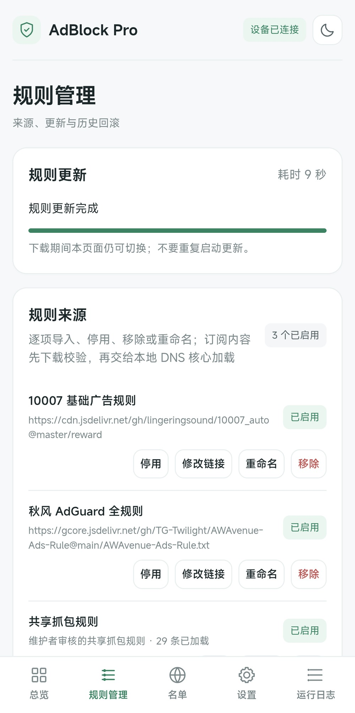

# AdBlock Pro

**本地过滤广告，自己补充规则，让有效的规则被更多人用上。**

基于 AdGuard Home 的 Android Root 去广告模块

[**下载安装**](https://github.com/Ccmra404/AdBlock-Pro-next/releases/latest) · [使用指南](docs/guide.md) · [共享规则](docs/shared-app-rules.md) · [反馈问题](https://github.com/Ccmra404/AdBlock-Pro-next/issues)

AdBlock Pro 在设备本地运行 DNS 过滤，提供中文 WebUI，管理订阅、个人黑白名单、日志和诊断。遇到漏拦截的广告，还能观察候选域名、复制给 AI 辅助分析，并把验证有效的规则提交到共享库。

## 界面预览

  
  
  

总览 · 域名观察 · 共享规则。实机截图，点击查看大图；条数与内存为截图时的设备状态。

## 从观察到共享

**观察域名 → AI 辅助分析 → 验证并导入 → 分享规则**

1. **观察**：在「名单」页选择本机应用，自动重新打开并短时观察 DNS 请求，默认 10 秒。
2. **分析**：勾选候选，点「复制给 AI 分析」，将域名和提示词粘贴到自己常用的 AI 工具。模块不内置 AI，也不需要 API Key。
3. **验证**：确认后加入个人名单，或导入 TXT / JSON；支持预览、去重和导出备份。修改后执行规则更新生效。
4. **共享**：点「提交候选」复制 GitHub 草稿链接，检查后手动提交。维护者审核发布后，其他设备即可同步；本机个人名单会保留。

观察结果可能包含后台应用请求，不能精确归属于所选应用，也不能直接认定为广告。AI 只辅助判断，加入拦截前仍需验证。模块不会自动向 AI 或 GitHub 上传 DNS 日志。

## 规则由你管理

安装包提供 **10007、秋风 AdGuard 全规则和共享规则快照**，首次安装即可加载。默认来源和自定义订阅统一管理，均可停用或移除；远程订阅可重命名、修改 HTTPS 链接，需要时也能重新导入。

个人黑白名单独立保存，放行名单可覆盖共享规则。订阅下载或校验失败时保留上一版有效规则，并提供历史恢复入口。规则规模会影响核心内存占用，按需启用即可。

查看规则管理截图

## 安装

1. 准备已 Root 的 **Android ARM64** 设备，停用会争用 DNS 端口或 AdGuard Home 服务的其他模块。
2. 从 [Releases](https://github.com/Ccmra404/AdBlock-Pro-next/releases/latest) 下载 ARM64 模块 ZIP，通过 Root 管理器安装并重启。`Source code` 压缩包不是安装包。
3. 打开 WebUI，在「总览」检查核心与 DNS 接管状态；需要调整来源或名单时，修改后执行规则更新。

| Root 环境 | WebUI 入口 |
| --- | --- |
| KernelSU 及兼容衍生版 | 支持模块 WebUI 的管理器 |
| Magisk | 兼容宿主，例如 [WebUI X](https://github.com/MMRLApp/WebUI-X-Portable) |
| APatch | 管理器 WebUI |

安装器会检查 BusyBox、curl 和 IPv4 iptables。当前 DNS 模式无需额外挂载元模块。已有 KernelSU/ReSukiSu 与 Magisk 版本的用户实测反馈；APatch 仍缺真机证据，不代表所有 ROM、宿主或最新完整安装包均已逐一验证。

AdGuard Home 原生后台入口位于「系统设置」，用于上游 DNS、完整查询日志等高级设置。首次安装默认为 `admin / password`，仅监听本机；升级保留已有账号。开放远程访问前先修改密码。

## 使用边界与恢复

- 默认接管 **IPv4 明文 TCP/UDP 53**，IPv6 DNS 接管默认关闭。私人 DNS、VPN 和应用加密 DNS 可能绕过过滤。
- DNS 过滤无法保证处理缓存广告、共用正常内容域名的广告或移除广告占位。域名观察不是 HTTPS 抓包；开屏跳过可独立搭配 [GKD](https://github.com/gkd-kit/gkd)。
- 规则条数不是广告命中次数，核心运行正常也不等于所有请求均已接管。

网络异常时，可从「系统设置 → 紧急解除接管」撤销本模块的 DNS 重定向，再查看运行日志。更多操作见[使用指南](docs/guide.md)。

## 贡献与致谢

欢迎提交可复现的问题和经过验证的规则。[共享规则贡献说明](docs/shared-app-rules.md#社区贡献) · [代码贡献指南](CONTRIBUTING.md) · [协作规范](AGENTS.md)

过滤引擎来自 [AdGuard Home](https://github.com/AdguardTeam/AdGuardHome)，预置规则来自 [10007](https://github.com/lingeringsound/10007_auto) 和 [AWAvenue Ads Rule](https://github.com/TG-Twilight/AWAvenue-Ads-Rule)。感谢 [KernelSU](https://github.com/tiann/KernelSU)、[Magisk](https://github.com/topjohnwu/Magisk)、[APatch](https://github.com/bmax121/APatch) 及相关工具作者。

由 **Ccmra** 维护。项目采用 [GPL-3.0](LICENSE)，第三方组件与规则遵循各自许可证，见 [THIRD_PARTY_NOTICES.md](THIRD_PARTY_NOTICES.md)。
